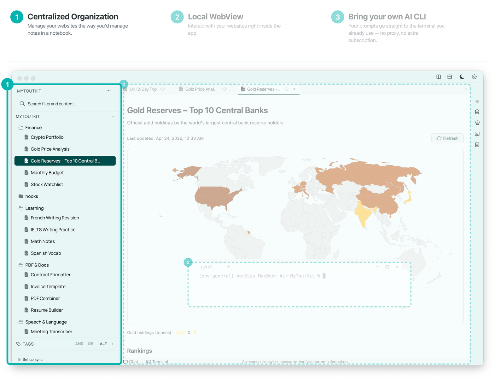

<p align="center">
  
  <picture>
    <source media="(prefers-color-scheme: dark)" srcset="assets/logo-fullname-dark.png">
    
  </picture>
</p>

<h1 align="center">A place for AI artifacts to live and evolve</h1>

<p align="center">
  NextProb is an open-source, agent-neutral desktop workspace for building, viewing, running, refining, and collecting AI artifacts.
</p>

<p align="center">
  <a href="https://youtu.be/ZjUs5zavs3E"></a>
  <a href="https://discord.gg/XErCw8DxX2"></a>
</p>

**Today, we face three frustrations:**

- **Chat buries your work.** → You learn a lot by chatting, but at the end none of it is noted down, organized, or stored anywhere you can return to.
- **Code folders lose you.** → Your self-built tools and personal workflows end up scattered across repos, with commands and dependencies you've long since forgotten.
- **Hosted builders lock you in.** → You want full control of your site or app — whether it stays local, is shared with a few people, is handed off to another agent, or none of the above. The key is that you want to gain control.

**NextProb** is a desktop app that pairs a sidebar of notes with a built-in terminal for AI CLIs (Claude, Codex, Opencode, Pi) and an in-app browser that renders whatever the AI writes.
Each note is a self-contained folder with its own SQLite database, key/value store, attached files, and scripts — so a note can grow from a static page into a sortable table, an interactive dashboard, or a research tool, without leaving your filesystem.
Everything stays on your disk; nothing syncs to a NextProb-run server unless you opt in.

<p align="center">
  
</p>

<p align="center">
  <a href="https://github.com/nextprob/nextprob/releases/latest"><strong>Download</strong></a> ·
  <a href="#install">Install from source</a> ·
  <a href="#see-it-work">See it work</a> ·
  <a href="https://youtu.be/ZjUs5zavs3E">Watch the demo</a>
</p>

---

## Demo

[Learn more about this idea on YouTube](https://youtu.be/ZjUs5zavs3E).

## What is NextProb

- **A terminal inside**: Just use Claude Code/Codex/Gemini CLI directly, like what you do in VS Code
- **A note management sidebar**: Just like any note application, arrange notes in hierarchy. The difference is that each note is actually a project folder behind on your system (while we don't need to think about that since that's handled by AI only).
- **The GUI - "Browser"**: NextProb has a "browser" in the app. So with one-click, any website can be displayed directly in it.
- **Also, a "backend"**: website in the app can have attached scripts to run. So your notes are no longer static, but can be dynamic, and merged into your workflow.
- **A special local storage structure**: Every note is a self-contained folder with its own SQLite database, key/value store, attachments, and scripts. Move the folder and the whole note — data, code, and all — moves with it.

## Who this is for
- If you like to write notes, and you want something more than text
- If you vibe code tools for yourself, and you want a place to collect them


## Install

The easiest way is to grab a pre-built release. Building from source is for people who want to hack on it.

### Download the app

[**Download the latest release →**](https://github.com/nextprob/nextprob/releases/latest)

### Run from source

If you'd rather clone and run, you'll need [Node.js](https://nodejs.org/) v18+ and npm:

```bash
git clone https://github.com/nextprob/nextprob.git
cd nextprob
npm ci
cp auth-config.example.json auth-config.json
npm start
```

`auth-config.json` holds endpoints for the optional cloud features (login, sync). The checked-in `auth-config.example.json` contains placeholder values — the app boots fine with them, but those features won't connect to anything until the values are filled in. Local-only features (workspace, notes, AI CLIs, terminal) work out of the box. Sharing uses your own GitHub account and doesn't need anything in `auth-config.json`.


## Source layout

Application code lives under `src/`, grouped by process and feature:

```text
src/
  main/               Electron startup, windows, IPC, and local bridge
  preload/            Bridges exposed to application and note pages
  renderer/           Workspace UI, styles, fonts, and browser libraries
  auth/               Authentication and GitHub access
  sync/               Workspace, note content, and server synchronization
  notes/              Note storage, preferences, tags, and backlinks
  import-export/      Importing, exporting, and publishing notes
  search/             Search indexes and query parsing
  workspace/          Templates, official skills, and workspace content
  terminal/           Terminal process management and detached terminal UI
  providers/          AI provider adapters
  project-config/     Project display configuration and validation
  project-model/      Filesystem discovery and collection evaluation
  project-settings/   Settings engine, catalog, schemas, and offline UI
  share-renderer/     Static GitHub Pages renderer for shared notes
tests/                Automated checks
scripts/              Development and release tools
assets/               Application icons and branding
bundled-skills/       Offline agent skill snapshot
export-app-template/  Standalone exported-note application
```

`package.json` starts Electron at `src/main/main.js`. Runtime modules use relative
imports; root resources such as `auth-config.json`, `assets/`, and
`bundled-skills/` stay at the application root in development and packaged builds.
Build configuration, dependency manifests, and project documentation also stay
at the repository root.

`src/main/main.js` wires application services together. Import, export, publishing,
and web clipping IPC handlers live in `src/import-export/ipc.js`; they receive
getters for the active workspace and window so switching projects uses current
application state.


## See it work

A quick walk-through of the everyday loop:

1. **Open a workspace** — pick an existing project folder, or create a new one from the sidebar. Your notes live as folders inside it.
2. **Open the terminal** — pop open the built-in terminal at the bottom of the window.
3. **Launch an AI CLI** — start `claude`, `codex`, or `opencode` right there, the same way you would in VS Code or any other IDE.
4. **Ask it to build something** — just tell it what you want: *"Make me a little page that introduces my favorite coffee shops, with photos and a map."* The agent writes the `index.html` (and any scripts or data it needs) straight into the note folder.
5. **See it render** — the viewer picks up the file and shows the page live. Edit the prompt, iterate, and the page updates in place — a GUI grown by conversation, sitting next to your notes on disk.


## How "backend" works?

In a normal web app, your frontend calls an API, the API runs some code on a server, that code reads or writes a database, and the frontend reads the updated data back. NextProb does the same thing — except the "server" is a script sitting next to your note, and the "database" is the `storage/` folder right next to it.

**The flow.** The page calls `window.noteScripts.run('fetch_data.py', [...])`. The script starts as a real subprocess (Python / Bash / Node / Ruby), with its working directory set to the note's `scripts/` folder and two environment variables injected: `NOTE_ID` (which note this is) and `WORKSPACE_PATH` (where the workspace lives on disk). From those two it can find everything else. stdout/stderr streams back to the page in real time and is also appended to `scripts/logs/{name}.log`. When the script exits, the page reads the updated storage via `noteDB` / `noteSQL` / `noteFiles` and re-renders. That's the full loop — the same shape as a click handler calling an endpoint that mutates a DB, except the "endpoint" is `scripts/fetch_data.py`, the "DB" is `storage/db.sqlite`, and nothing ever leaves your machine.

**Scripts share the same storage as the page.** This is the important part: the script can write straight into the note's own storage folder, and the page will read exactly the same bytes back:

- `../storage/kv.json` — any language can open a JSON file. Append a field, the page picks it up on next `noteDB.get()`.
- `../storage/db.sqlite` — any language with a SQLite binding (Python's `sqlite3`, Node's `better-sqlite3`, Ruby's `sqlite3`, the `sqlite3` CLI in Bash) can open this file and `INSERT`/`UPDATE`/`SELECT` against it. The DB runs in WAL mode so the page and the script can hold handles at the same time without blocking each other.
- `../storage/files/` — drop a downloaded PDF, a generated chart, a cached dataset here. `noteFiles.load()` on the page reads it back.

So a Python script can `pip install requests`, hit an API, parse the JSON, and `INSERT` rows into `db.sqlite`; the page then queries those rows and renders a table. That's the classic "frontend → API → database → frontend" pattern, fully local, zero deployment.

**Safety rails.** Scripts are **off by default** — every script has to be explicitly approved from the UI before it can run, and approvals are stored per-note in `.notes-app/script-whitelist.json`. A note can only execute files inside its own `scripts/` folder (path traversal attempts are rejected at the IPC layer), and it can only pass string arguments, capped in count and size. If you want to stop a long-running script, `noteScripts.stopByName('fetch_data.py')` from the page kills it.

**Per-note Python environments.** Drop a `.venv/` inside a note's `scripts/` folder (or at the note root) and NextProb auto-detects it — Python scripts for that note run through that interpreter, with `PATH` and `VIRTUAL_ENV` set correctly. Each note can pin its own dependencies without leaking them into your system Python.

**Why this matters.** Because the script and the page share `storage/`, you can build a real tiny app inside a single note: an HTML dashboard backed by scripts that fetch, transform, and save data into SQLite. No server to deploy, no auth to wire up, no API to version. The "cloud" is just a subdirectory, and the "backend" is whatever language you like.


## How "notes" are stored

Each note in your workspace is a **folder**, not a single file. The folder is the note, and everything the note needs lives next to it on disk:

```
my-workspace/
├── research-on-kafka/          ← one note
│   ├── index.html              ← what you see in the viewer
│   ├── storage/
│   │   ├── kv.json             ← noteDB: simple key/value store the page can read/write
│   │   ├── db.sqlite           ← noteSQL: per-note SQLite database (WAL mode)
│   │   └── files/              ← noteFiles: binary/blob store (images, CSVs, PDFs, audio…)
│   └── scripts/
│       ├── fetch_data.py       ← scripts the note is allowed to run
│       ├── build_chart.sh
│       └── logs/               ← stdout/stderr captured per run
├── meeting-2026-04-15/
│   └── index.html
├── _templates/                 ← folder-based templates (copied verbatim on "New from Template")
└── .notes-app/                 ← workspace-level app state (local, safe to delete)
    ├── favorites.json
    ├── script-whitelist.json
    └── search.db               ← Lunr + SQLite metadata index
```

**Why folders instead of flat files.** Once a note is just `index.html`, it can only be text. Once it's a folder, it can be a tiny website with its own data, code, and assets. The note becomes self-contained — you can zip the folder, hand it to someone else, and everything still works.

**Per-note storage — three kinds, one folder.** The viewer exposes three storage APIs to the page's JavaScript, picked to match the shape of the data:

- **`noteDB`** — a JSON key/value store backed by `storage/kv.json`. Best for small, structured state: form values, user preferences, toggles, cached settings. Form inputs on the page are actually auto-persisted here, so typing into a field and reloading just works.
- **`noteSQL`** — a real SQLite database at `storage/db.sqlite`, powered by `better-sqlite3` in WAL mode. The page issues `exec`/`query` calls over IPC; the main process is the only thing that ever touches the file. Use this when the note needs tables, joins, or more than a few KB of data — logs, datasets, time series, anything you'd reach for a database for.
- **`noteFiles`** — a binary/blob store at `storage/files/`. `save`, `load`, `delete`, `list`, `import` from disk. This is where big things go: images, CSVs, PDFs, audio, downloaded datasets — anything too bulky for JSON or SQL cells.

Together these cover the full range: tiny state in `noteDB`, structured/queryable data in `noteSQL`, and large opaque blobs in `noteFiles`. A note about running experiments can insert rows into SQLite as you run them. A reading list can store entries in SQL and re-render the table on every open. A data-exploration note can `import` a 200 MB CSV into `storage/files/` once, then read it back without re-uploading. Because all three live inside the note folder, moving the folder moves the note *and* all of its data — nothing is stranded in an app-wide database somewhere else on your disk.

**Attached scripts.** Anything you drop into a note's `scripts/` folder can be executed from the note itself — Python (`.py`), Bash (`.sh`), Node (`.js`), or Ruby (`.rb`). Scripts are **off by default**: you explicitly approve each one from the UI before it can run, and approvals are stored per-note in `.notes-app/script-whitelist.json`. Output is streamed back to the page and also tee'd to `scripts/logs/{name}.log` (auto-rotated) so you can inspect what a script did after the fact. Combined with `kv`/`sql`, this means a note can fetch data on demand, write it into its own database, and re-render — a small, self-contained workflow, not a static document.

**Workspace-level state.** The `.notes-app/` folder at the workspace root holds things that don't belong to any single note: favorites, the script whitelist, the Lunr full-text index, and cached SQLite metadata. It's regenerable — deleting it loses UI state like starred notes but never loses note content. It's also automatically added to `.gitignore` so you don't accidentally commit it.

**What this means in practice.** Your workspace stays fully inspectable with plain tools (`ls`, `grep`, `git`), your notes are portable (copy the folder, you have the note and its data), and each note can grow from a static page into a tiny interactive app without leaving the filesystem.


## Features

**Terminal — where you talk to AI.** NextProb has a built-in terminal that sits right underneath the main window. It's where you chat with Claude, Codex, or Gemini and ask them to do things: write a note, pull some data, summarize a PDF, build a little tool. If you've seen a black window with text in it before, this is the same thing — and if you haven't, don't worry: once you start one of the AI tools, you just type what you want in plain English.

You can open several terminal tabs at once, so one can be Claude writing a note while another is Codex working on something else. Each tab shows a small glowing dot when the AI is thinking, so you always know which one is waiting for you. You can also drag the terminal out into its own window if you'd like more room.

**Note Management — your notes, organized.** The sidebar on the left shows all your notes in a folder tree, just like Finder on a Mac or File Explorer on Windows. You can create folders, drag notes around, rename them, delete them, and search across every note's title and content from the box at the top. A "Favorites" section keeps the notes you use most at the top, and a "Tags" section lets you group notes by topic (e.g. #travel, #recipes) and filter the tree down to just those.

Every note is a real folder on your computer — nothing is locked inside the app. That means you can also move notes around in Finder, back them up to iCloud or Dropbox, or zip a note up and email it to a friend. The app picks up whatever you do on disk automatically.

**Backend Scripts — give your notes superpowers.** A normal note is just a page you read. In NextProb, a note can also *do things*: fetch the latest weather, pull your bank transactions, summarize a PDF you just dropped in, regenerate a chart from fresh data. It does this by running little helper scripts that live next to the note — written by the AI for you, in Python or a similar language. You don't need to know how they work; you just click a button on the note and something happens.

Safety first: no script ever runs without your permission. The first time a note wants to run something, NextProb asks you to approve it, and you can revoke that approval any time. Approvals are remembered per note, so you only get asked once per script.

**Local databases — notes that remember things.** Regular notes forget everything between visits. NextProb notes can store structured information right inside themselves: a running list of books you've read with ratings, a log of workouts, a table of contacts, a price history of something you're tracking. The data lives in a small private database attached to the note, so the note can show you a sortable, filterable table instead of a static list.

All of this is stored inside the note's own folder. If you move or copy the note, the data moves with it. There's no separate "library" file to worry about and nothing syncs to a company server you don't control.

**Website memory storage — fill in forms without losing them.** If a note has a form — a text box, a checklist, a dropdown, a draft area — whatever you type is remembered automatically. Close the note, come back a week later, and everything you'd filled in is still there. This is what makes a NextProb note feel like a real tool instead of a static page: a weekly review template keeps last week's answers, a packing list remembers what you checked off, a journal keeps your draft safe even if the app crashes.

You don't configure anything for this to work — it just happens. If you ever want to start fresh, there's a reset option in the note's menu.

**Sharing — publish a note from your own GitHub (optional).** When you want to send a note to someone else, NextProb publishes it through *your* GitHub account, not a NextProb server. The first time you share, you connect GitHub once (device-code login, no password typed into the app) and pick a name for a small repo on your account — `my-shared-notes` by default. NextProb creates that repo, drops in a tiny renderer page, and turns on GitHub Pages for it. After that, each time you share a note, the note's HTML is saved as a **gist** on your account (public or secret, your choice) and the share link points at your Pages site, which loads the gist and shows the note. Nothing about the note ever touches a NextProb-run server — the gist lives in your GitHub, the renderer lives in your repo, and the link is `https://<your-username>.github.io/<your-repo>/?id=…`. Disconnecting GitHub later doesn't break the links you've already shared.

**Sync — your notes, everywhere (optional).** If you'd like your notes on more than one computer, you can turn on sync and NextProb will keep everything mirrored in the background: text, form data, attached files, the whole thing. It works the way you'd expect — edit something on your laptop, open your desktop, and the change is already there. If you go offline, it waits patiently and catches up when you're back online. If two devices edit the same note at once, NextProb tells you instead of silently picking a winner.

Sync is **off by default and completely optional**. If you never turn it on, your notes never leave your computer — no account, no cloud, no tracking.


## License

NextProb is licensed under the **GNU Affero General Public License version 3.0 (AGPL-3.0-only)**. See [`LICENSE`](LICENSE) for the full text.

The "NextProb" name and the "Helicase.space" brand (including typographic variants such as "Helicase Space" and "Helicase"), together with the icon files under `assets/` (`icon.icns`, `icon.png`), are **reserved marks and assets of Helicase Space LLC** and are **not** licensed under the AGPL. See [`NOTICE`](NOTICE) for details. If you fork or redistribute a build of this app, please use your own product name and icon rather than NextProb's branding.

Third-party dependencies and their licenses are listed in [`THIRD_PARTY_LICENSES.md`](THIRD_PARTY_LICENSES.md).

Contributions are welcomed under the terms of the [Contributor License Agreement](CLA.md).

---

Thank you.

## Project display configuration

Create `nextprob.config.json` in your project root to configure the sidebar. The app reloads valid edits automatically. Without this file, it uses the existing Favorites and project file tree layout. Invalid edits show a sidebar message and retain the last valid configuration; deleting the file restores defaults. The app does not rewrite your configuration.

Collections define reusable sets of project items. Surface sections choose their order, labels, and list or tree presentation. For example:

```json
{
  "version": 1,
  "collections": {
    "templates": {
      "source": "notes",
      "where": { "in": ["_templates", { "var": "ancestorPaths" }] },
      "sort": "title"
    }
  },
  "surfaces": {
    "sidebar": {
      "sections": [
        { "id": "favorites", "title": "Favorites", "view": "list", "collection": "favorites", "hideWhenEmpty": true },
        { "id": "templates", "title": "Templates", "view": "list", "collection": "templates" },
        { "id": "files", "title": "Probs", "view": "tree", "source": "items", "hiddenFolders": ["tmp", "_templates"] }
      ]
    }
  }
}
```

`favorites` is a built-in collection backed by `.notes-app/favorites.json`, including its manual order. You can replace its collection definition. Explicit `sections` arrays replace the default section list; `[]` hides all sections. Section IDs must be unique and stable because personal collapse state is stored separately under those IDs. Sections require exactly one `source` or `collection`. Sources are `items` (navigable files and folders) and `notes` (folder notes containing `index.html`, HTML, Markdown, and text files).

`hiddenFolders` applies to tree sections and contains exact project-relative directory paths using `/`: `tmp` hides the root directory and its descendants, while `work/tmp` hides that nested directory. This changes only that tree's display; a favorite inside a hidden folder remains available in another section. Resource defaults and project edits are combined into the effective folder list for each tree section. By default dot names are hidden from trees; set `surfaces.sidebar.hideDotFolders` to `false` to display them. Technical directories such as `.git`, `node_modules`, `.notes-app`, and note storage remain outside discovery, as do symlinks and the config file itself.

`hiddenFiles` applies to a tree section and accepts case-sensitive filenames at any depth (`GEMINI.md`) or exact project-relative file paths (`work/private.md`). Wildcards are not supported. It hides files only, leaving matching directory names and other collections available. Settings shows the complete effective file list, combining resource defaults with project edits.

Official exclusions live in the resources repository's `settings/note-exclusions.json`. They supply the starting file and folder lists for every tree section, including saved custom sections. Users can edit or remove any of those defaults. Resource updates do not rewrite project files. The existing content download and versioned settings cache deliver updates when a project opens, notify the active sidebar, and retain the latest compatible package for offline startup. To publish a new official filename, edit that resource and increment `settings/catalog.json`'s publication `revision`; no app rebuild or project migration is required once this runtime support is installed. Invalid, incompatible, or older packages cannot replace the active cache. Legacy packages without the resource use bundled exclusions.

Each tree section has two editable fields: **Excluded folders** and **Excluded files**, with one entry per line. They show all effective exclusions without separate default or personal lists. Removing a default takes effect immediately after saving and remains removed across resource updates; new defaults still arrive automatically. Favorites and other list collections remain available. Removing a default dot-folder exclusion also permits that folder through the dot-name filter; unrelated dot names remain hidden. Technical discovery boundaries remain outside these display lists.

Project files store additions in `hiddenFiles` / `hiddenFolders` and remembered removals in `shownFiles` / `shownFolders`. Those removal lists are persistence metadata; they are not extra UI fields. Existing saved exclusion arrays remain compatible. Resource updates add new defaults while retaining explicit removals, including if a removed default disappears and later returns.

Other display defaults are maintained at `settings/project-config.default.json`. Run `node scripts/sync-official-skills.js <resources-repo>/skills` to refresh the app's bundled offline resources and portable skill assets; `--check` detects unsynchronized copies. This sync refreshes fallback assets for a release; it is not required to deliver later official-exclusion updates to installed apps. Internal discovery boundaries remain in app code.

Rules use a bounded subset of [JSONLogic](https://jsonlogic.com/). Supported operators are `var`, `===`, `!==`, `==`, `!=`, `>`, `>=`, `<`, `<=`, `and`, `or`, `!`, `!!`, and `in`. Rules may read `relativePath`, `kind` (`note`, `file`, or `folder`), `title`, `name`, `extension`, `ancestorPaths`, `modifiedAt`, `favorite`, `favoriteOrder`, `capabilities`, `capabilities.open`, and `capabilities.createFromTemplate`. Paths and ancestors are relative to the project root; extensions omit the dot; timestamps use milliseconds. Rules cannot execute JavaScript or access the filesystem. Tags and full-text filtering are not exposed by this first version.

Collection and section `sort` values are `title`, `name`, `path`, `modifiedAt` (newest first), or `favoriteOrder`. Section sorting overrides collection sorting. `hideWhenEmpty` suppresses empty sections. Explicit project sorting takes precedence; the existing file tree uses its interactive sort control when no project sort is configured. Labels and rules determine display, while existing note and template operations remain application behavior: a Templates group does not change the template picker's `_templates` discovery convention.

The versioned format is described in [src/project-config/schema.json](src/project-config/schema.json). The implementation separates configuration loading and validation (`src/project-config/`), filesystem discovery and collection evaluation (`src/project-model/`), and sidebar presentation (`src/renderer/surfaces/`). Additional surfaces can consume the same collections through their own adapters; only `sidebar` is supported in version 1.

## Official agent skills

Opening a project automatically installs NextProb's official guidance into `.agents/skills/nextprob/` (Codex) and `.claude/skills/nextprob/` (Claude Code). OpenCode recognizes both native locations. The skill teaches agents how to edit file-backed project settings, including `nextprob.config.json`, ignore rules, and instruction files; the user can ask for changes naturally. Installing the skill does not create a config file. Start the agent in the project after opening it in NextProb; a running agent may need to reload skills to discover a new installation.

The app installs a bundled offline copy first, then checks for compatible updates through the same content-repository archive used for templates. Skills have a separate version manifest and ownership records in `.notes-app/official-skills.json`. NextProb preserves existing user-created skill folders and edited copies, and never downgrades a newer managed skill to an older bundled version. Only NextProb's skill folders are excluded from project syncing; unrelated custom skills remain user-owned. Guidance does not appear as notes in the sidebar.

Maintainers author the package in the content repository's `skills/` directory and setting definitions in its sibling `settings/` directory. Refresh its generated config assets, settings catalog, and this app's offline snapshot with `npm run sync:official-skills -- ../hs-update-model-list/skills`. Run `npm run check:official-skills` to verify the snapshot matches current config definitions; builds run this check automatically. Increment the skill manifest version whenever its content changes.


## File-backed project settings

Project Settings reads and edits the original project files. Its catalog describes discovery and presentation; it contains no copies of project setting values. Files edited in another editor or by an agent remain the source of truth. Source editing remains available for formats or fields that a friendly view cannot interpret.

The settings interface is an HTML note with a dedicated, versioned `window.settings` bridge. Its default HTML, CSS, bootstrap, and reusable renderer are maintained in `hs-update-model-list/settings/ui/`; [src/project-settings/ui/](src/project-settings/ui/) is the generated offline mirror. Compatible downloaded content snapshots can update the default independently of an application release. Use the Project Settings host controls to choose a project-local HTML note, create an editable copy of the maintained default, or restore the default interface. Custom HTML controls presentation; the application continues to own file access, validation, drafts, and conflict detection. Ordinary notes receive no settings access, and settings controls are not automatically persisted through `noteDB`. See [Settings HTML notes](docs/settings-html.md) for the public API and an example.

Built-in definitions are shipped through the content repository's `settings/catalog.json`; [src/project-settings/catalog.json](src/project-settings/catalog.json) is this app's offline mirror. Users add or customize definitions in `nextprob.settings.json` at their own project root, starting with `{"version": 1, "definitions": []}`. Local definitions extend built-ins and replace an entire built-in definition when their IDs match. The [catalog schema](src/project-settings/catalog.schema.json) describes the versioned contract. To expose another file, add a local definition with exact relative paths or directory matches, labels, a supported editor format, explicit creation content, and optional schema or managed-section markers. No file-specific application code is required for resources handled by the existing text, Markdown, JSON, or ordered-rule editors. New grammars or runtime behaviors can require engine changes.

Schema paths in user definitions are relative to the project root. Users can supply project-local schemas with field labels, descriptions, enum choices, and validation. Valid changes to `nextprob.settings.json` hot reload; invalid edits show diagnostics and retain the last valid local definitions during the session. Deleting the file removes local customizations. No application checkout or build commands are required for user customization.

Maintainers update shipped defaults, including the HTML settings interface, in the content repository's `settings/` directory, with schema paths relative to that catalog. `npm run sync:official-skills -- ../hs-update-model-list/skills` refreshes generated app and skill assets; `npm run check:official-skills` verifies the offline snapshot without network access. Edit the canonical content resources rather than their app mirrors. Downloaded built-ins come from the app's content archive and retain their UI assets together as one compatible snapshot; broken updates leave a usable snapshot active. Content updates preserve custom note selection and project-local files. Installed skill assets are documentation snapshots, never the engine's definition source.

Ignore rule order and comments, JSON fields, and original source formatting remain meaningful. Automatically updated sections are identified by delimiters declared in the catalog. Built-in sync exclusions and runtime defaults still come from their respective consumers. Adding a file to the settings catalog makes it editable; it does not add a new consumer for its behavior.
